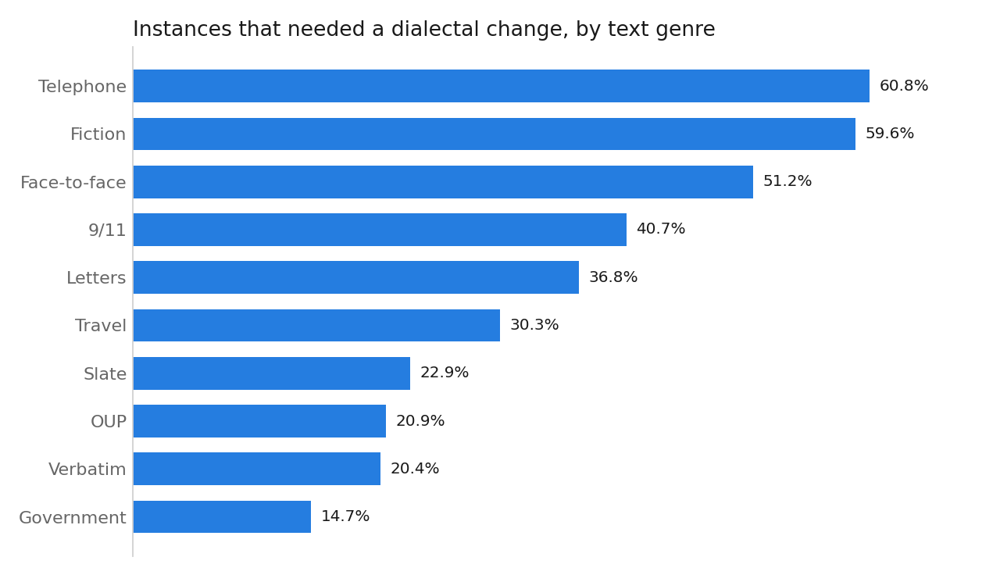
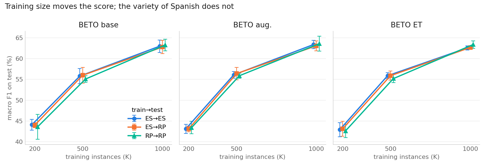

# Dialectal representation in NLP: Rioplatense Spanish

Datasets, pipelines and results of my undergraduate thesis in Data Science at the University of Buenos Aires (Faculty of Exact and Natural Sciences, 2026): **"Dialectal Representation in NLP: A Benchmark for Rioplatense Spanish and Eye-Tracking-Guided Data Augmentation"**, supervised by Bruno Bianchi and co-supervised by Fermín Travi.

📄 **[Read the full thesis (PDF, in Spanish)](docs/thesis_Kaufmann_2026.pdf)**

## Introduction

Natural language processing has advanced remarkably by training on huge amounts of text, but not evenly across the world's language varieties. Models are evaluated on benchmarks built mostly in English, and the Spanish versions that exist reflect a European or neutral standard.

Rioplatense Spanish, spoken by around 50 million people in Argentina and Uruguay, is absent from those resources. The differences are not superficial: the vocabulary diverges systematically, *voseo* has its own verb paradigm (*hablás, tenés, vení*), and speakers prefer the simple past (*comí*) over the compound one (*he comido*) and the periphrastic future (*va a llover*) over the simple one (*lloverá*). All of this changes which words a model sees often and which it finds likely.

A second motivation comes from the [Cuentos corpus](https://doi.org/10.1038/s41597-026-06798-z), which records the eye movements of 113 native Rioplatense readers as they read short fiction. Work on English suggests that eye-tracking signals can help language models, especially when little training data is available.

I asked two questions:

- **H1.** Does the distance between European and Rioplatense Spanish hurt [BETO](https://github.com/dccuchile/beto)'s performance on natural language inference when the model was not exposed to Rioplatense during training?
- **H2.** Do eye-tracking signals from native Rioplatense readers improve BETO on comprehension tasks, particularly with little fine-tuning data (K = 200, 500 and 1,000)?

**Short answer: neither hypothesis was confirmed.** The lasting contribution is the two datasets and the pipelines that built them.

## What is in this repository

| Folder | Content |
|---|---|
| [`xnlirp/`](xnlirp/) | **XNLIrp**: an adaptation of XNLI to Rioplatense Spanish, 7,500 instances aligned one to one with the European Spanish originals. Dataset, prompts, scripts and native speaker ratings. |
| [`qa_cuentos_et/`](qa_cuentos_et/) | **QA-Cuentos ET**: answer sentence selection over the Cuentos corpus, 1,788 questions and 8,940 instances. Dataset, prompts and scripts. |
| [`docs/`](docs/) | The thesis and the script that draws the figures below. |

To my knowledge, they are the first adaptation of XNLI and the first reading comprehension dataset for Rioplatense Spanish.

## XNLIrp: how different are the two varieties?

XNLIrp adapts the 7,500 evaluation instances of [XNLI](https://github.com/facebookresearch/XNLI) from its professional European Spanish translation, changing as little as possible and keeping the inference label.

| Type | Meaning | Example (European → Rioplatense) | Instances | Share |
|---|---|---|---|---|
| A | no change | | 3,809 | 50.8 % |
| B | vocabulary and tense | *coger los totales* → *agarrar los totales* | 1,206 | 16.1 % |
| C | grammar and *voseo* | *busca esto* → *buscá esto* | 528 | 7.0 % |
| D | fixes an error in the Spanish translation | *a las afuera* → *a las afueras* | 1,115 | 14.9 % |
| E | cultural adaptation | *Rick* → *Ricardo* | 842 | 11.2 % |

About half of the instances (49.2 %) needed some change, and 34.3 % show a dialectal change proper (B, C and E). How much changes depends heavily on the kind of text:



### Quality control

1. **Automatic grader** (gpt-4o-mini). On a manually reviewed development set of 200 instances it reached 98.5 % accuracy (191 of the 194 with a parseable verdict). Instances it flagged went to correction.
2. **Native speaker validation** in a web app: 7,120 responses from 340 annotators, mean naturalness 3.73 out of 5, with 84.2 % of numeric ratings at 3 or above. Ratings do not cover all 7,500 instances.
3. **Correction pass** over everything flagged by the grader or by annotators, including a second Gemini translation that received the annotators' feedback.

## Results

All experiments use BETO. Three variants are compared: **base** (the original model), **aug.** (further pretrained on the Cuentos stories, as a domain control) and **ET** (further pretrained on the same stories using real eye-tracking scanpaths).

### H1: no relevant dialectal gap

Macro F1 (%) on natural language inference, mean ± standard deviation over 3 seeds. Type D instances are excluded, because there the Rioplatense text also fixes a translation error and the comparison would not be fair.

| K | Model | ES→ES | ES→RP | RP→RP |
|---|---|---|---|---|
| 200 | base | 44.1 ± 1.3 | 44.0 ± 0.6 | 43.6 ± 3.0 |
| 200 | aug. | 43.1 ± 1.1 | 43.1 ± 0.7 | 43.4 ± 1.5 |
| 200 | ET | 42.9 ± 1.7 | 43.1 ± 1.8 | 42.6 ± 1.6 |
| 500 | base | 55.8 ± 1.8 | 56.0 ± 1.9 | 55.1 ± 0.8 |
| 500 | aug. | 56.1 ± 0.8 | 56.4 ± 1.5 | 55.9 ± 0.6 |
| 500 | ET | 55.9 ± 0.7 | 55.9 ± 1.1 | 55.2 ± 1.0 |
| 1000 | base | 63.0 ± 1.5 | 62.8 ± 1.6 | 63.3 ± 1.4 |
| 1000 | aug. | 63.4 ± 1.0 | 63.1 ± 1.2 | 63.6 ± 1.8 |
| 1000 | ET | 62.6 ± 0.5 | 62.7 ± 0.3 | 63.4 ± 0.9 |



Training on one variety or the other makes no difference beyond the noise between seeds, while going from 200 to 1,000 examples adds about 20 points.

With full training (390,702 European Spanish pairs), tested on all 7,500 instances:

| Test subset | Accuracy gap, Rioplatense minus European |
|---|---|
| All instances | +0.3 points (accuracy 81.5 vs 81.3) |
| Only type D (translation errors fixed) | +3.5 points |
| Without type D | -0.3 points |
| Dialectal change proper (B, C, E) | -0.7 points |

There is a gap in favour of European Spanish once the fixed translation errors are removed, but it is below one point. Part of it comes from an encoding error that was present when the experiments ran (see [changes since the thesis](#changes-since-the-thesis)).

### H2: eye-tracking did not help

On NLI, BETO ET never beats the domain control (BETO aug.) in any of the nine settings above. On QA-Cuentos ET, the task built on the very stories the model had seen, macro F1 (%) over 5 seeds:

| Model | K = 200 | K = 500 | K = 1000 |
|---|---|---|---|
| base | 83.0 ± 2.2 | 86.3 ± 0.7 | 87.5 ± 0.2 |
| aug. | 83.7 ± 2.6 | 85.9 ± 1.0 | 87.7 ± 0.9 |
| ET | 83.7 ± 2.3 | 86.1 ± 0.8 | 87.3 ± 0.5 |

The differences between models are within one standard deviation everywhere. Stories that have eye-tracking data score somewhat higher than stories without it, but the model that never saw any eye-tracking signal shows the same pattern, so it reflects the stories (the two groups differ in length) and not the signal.

## Limitations

- XNLIrp adapts text that was already a translation from English, so it is not native Rioplatense text and may understate the real gap.
- Premise and hypothesis were adapted together, for consistency of names and references. This may add lexical overlap that the independently translated originals do not have.
- Only BETO was tested. The results do not transfer directly to larger models.
- The eye-tracking corpus is small (20 stories with signal), and biasing masked language modelling may not be the best way to pass the signal to the model.

## Changes since the thesis

The experiments in the thesis ran on a version of XNLIrp in which 86 instances had corrupted accented characters in the Rioplatense text (UTF-8 read as Windows-1250). I fixed them in this repository, including their `changes` and `note` fields, and recomputed their Levenshtein distances. Their indices are listed in [`xnlirp/encoding_fix_ids.txt`](xnlirp/encoding_fix_ids.txt).

The results above are the original ones: I did not retrain. In the full training experiment, leaving these instances out moves the gap on dialectal instances from -0.74 to -0.52 points, so the conclusion on H1 does not change.

## Data sources and terms

- XNLIrp is derived from [XNLI](https://github.com/facebookresearch/XNLI) (Conneau et al., 2018), released under [CC BY-NC 4.0](https://creativecommons.org/licenses/by-nc/4.0/).
- QA-Cuentos ET contains sentences from the stories of the Cuentos corpus ([data on figshare](https://doi.org/10.6084/m9.figshare.28311908)). The rights to each story belong to its author.

## How to cite

```
Kaufmann, T. (2026). Representación dialectal en NLP: un benchmark para el
español rioplatense y enriquecimiento de datos guiado por eye-tracking.
Tesis de Licenciatura en Ciencias de Datos, Universidad de Buenos Aires.
```

## References

Papers this work builds on or reads closely. The full bibliography is in the thesis.

- Baldissin, G., Schlechtweg, D. and Schulte im Walde, S. (2022). DiaWUG: A dataset for diatopic lexical semantic variation in Spanish. *LREC 2022*.
- Bengoetxea, J., Gonzalez-Dios, I. and Agerri, R. (2025). Lost in variation? Evaluating NLI performance in Basque and Spanish geographical variants. *CoNLL 2025*.
- Cahyawijaya, S. et al. (2025). Thank you, Stingray: Multilingual large language models can not (yet) disambiguate cross-lingual word senses. *Findings of NAACL 2025*.
- Cañete, J. et al. (2020). Spanish pre-trained BERT model and evaluation data. *PML4DC at ICLR 2020*.
- Conneau, A. et al. (2018). XNLI: Evaluating cross-lingual sentence representations. *EMNLP 2018*.
- Deng, S. et al. (2024). Fine-tuning pre-trained language models with gaze supervision. *ACL 2024*.
- Goldfarb-Tarrant, S., Ross, B. and Lopez, A. (2023). Cross-lingual transfer can worsen bias in sentiment analysis. *EMNLP 2023*.
- Hershcovich, D. et al. (2022). Challenges and strategies in cross-cultural NLP. *ACL 2022*.
- Hu, J. et al. (2020). XTREME: A massively multilingual multi-task benchmark for evaluating cross-lingual generalization. *ICML 2020*.
- Lopetegui, J. A., Riabi, A. and Seddah, D. (2025). Common ground, diverse roots: The difficulty of classifying common examples in Spanish varieties. *VarDial 2025*.
- Pérez, J. M. et al. (2023). Assessing the impact of contextual information in hate speech detection. *IEEE Access*. https://doi.org/10.1109/ACCESS.2023.3258973
- Pérez, J. M., Miguel, P. and Cotik, V. (2025). Exploring large language models for hate speech detection in Rioplatense Spanish. *Findings of NAACL 2025*.
- Srirag, D. et al. (2025). BESSTIE: A benchmark for sentiment and sarcasm classification for varieties of English. *Findings of ACL 2025*.
- Travi, F. et al. (2025). Exploring the integration of eye movement data on word embeddings. *CMCL 2025*.
- Travi, F., Bianchi, B., Fernández Slezak, D. and Kamienkowski, J. E. (2026). Cuentos: A large-scale eye-tracking reading corpus on Spanish narrative texts. *Scientific Data*, 13, 434. https://doi.org/10.1038/s41597-026-06798-z
- Wang, A. et al. (2019). GLUE: A multi-task benchmark and analysis platform for natural language understanding. *ICLR 2019*.
- Yang, D. and Hollenstein, N. PLM-AS: Pre-trained language models augmented with scanpaths for sentiment classification. https://doi.org/10.7557/18.6797
- Zhang, L. and Hollenstein, N. (2024). Eye-tracking features masking transformer attention in question-answering tasks. *LREC-COLING 2024*.

## Contact

Tadeo Kaufmann · tadeokaufmann1@gmail.com · [LinkedIn](https://www.linkedin.com/in/tadeo-kaufmann/)
